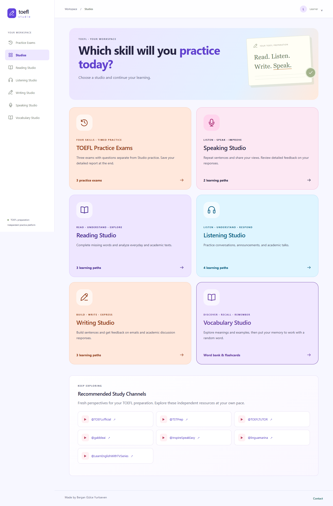
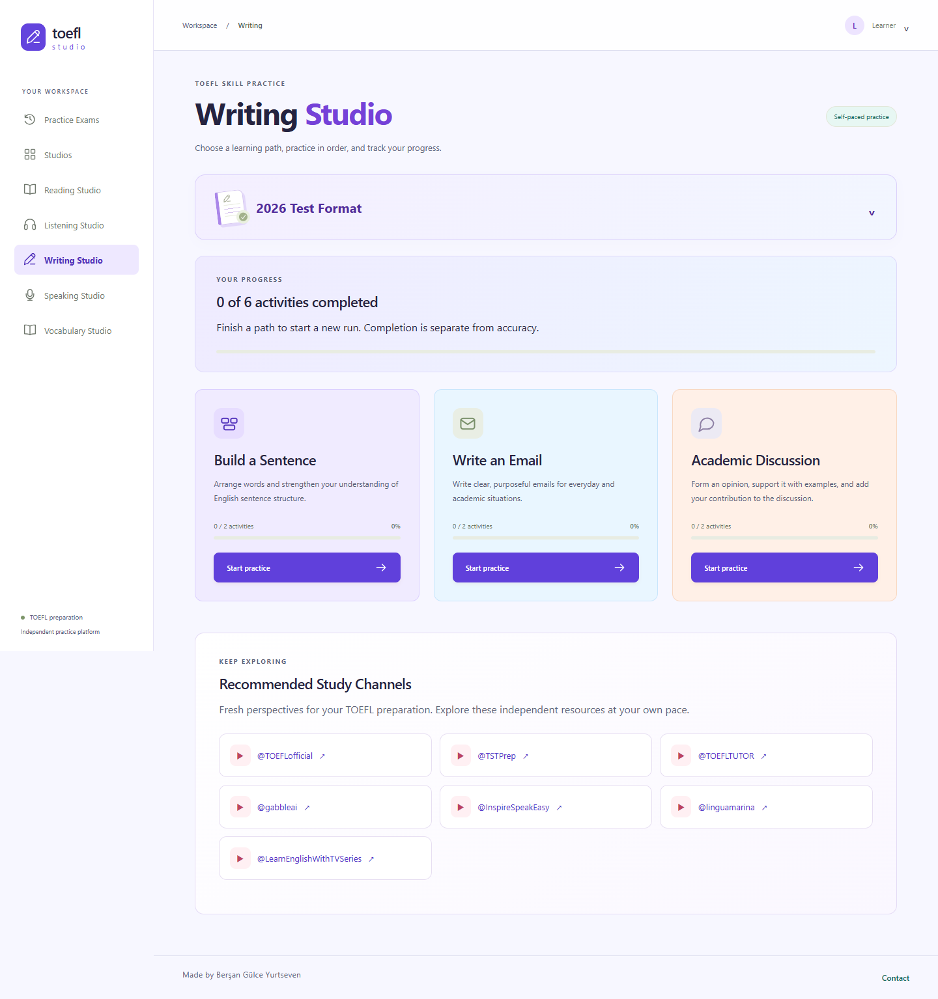
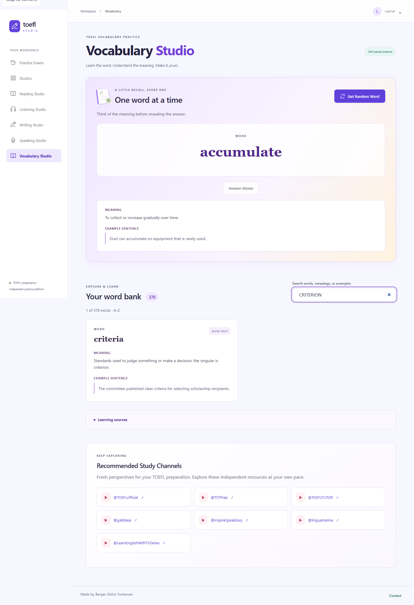
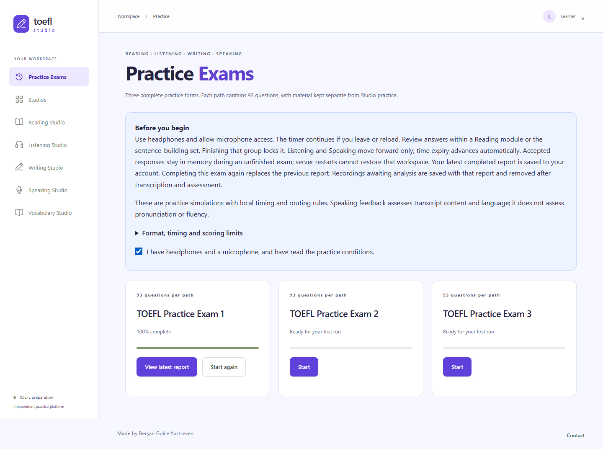

# TOEFL Studio

**TOEFL hazırlığını, sıralı alıştırmaları ve yapay zeka destekli geri bildirimi tek yerde buluşturan web uygulaması.**

ASP.NET Core, React ve SQL Server ile geliştirildi. Öğrenciler beş stüdyoda çalışabilir, ilerlemelerini takip edebilir ve üç farklı zamanlı deneme sınavını tamamlayabilir. Uygulamanın arayüzü İngilizcedir.

> Bağımsız bir eğitim projesidir; ETS ile bağlantılı değildir. AI geri bildirimleri ve tahmini puanlar hata içerebilir, resmi TOEFL sonucu yerine geçmez.



[Kurulum](#yerelde-çalıştırma) · [Ayarlar](#yapılandırma) · [Raporların saklanması](#sınav-raporları-nasıl-saklanır)

## Neler sunuyor?

| Alan | İçerik |
| --- | --- |
| **Reading Studio** | Complete the Words, Read in Daily Life, Read an Academic Passage; eksik harf sayısını gösteren alanlar ve kelime vurguları |
| **Listening Studio** | Listen and Choose a Response, Conversation, Announcement ve Academic Talk; sesli materyaller |
| **Writing Studio** | Build a Sentence, Write an Email, Write for an Academic Discussion; görev bazlı geri bildirim |
| **Speaking Studio** | Listen and Repeat ve Take an Interview; mikrofon kaydı, transkripsiyon ve metin üzerinden AI değerlendirmesi |
| **Vocabulary Studio** | 378 kelime/ifade, İngilizce anlam ve örnek cümle; arama ve aynı sayfada açılan flashcard |
| **Practice Exams** | Stüdyo havuzundan ayrı üç deneme; zamanlayıcı, bölüm bazlı navigasyon, cevap incelemesi, çalışma önerileri ve PDF çıktısı |

- Kullanıcı adı veya e-posta ile giriş; kişisel profil ve çalışma hedefleri.
- Stüdyolarda sıralı etkinlikler, tamamlanma yüzdesi ve tamamlanan yolu yeniden başlatma.
- Reading modülü ve Build a Sentence seti içinde cevapları gözden geçirme; Listening ve Speaking'de ileri yönlü akış.
- Yanlış cevaplara dayalı AI çalışma önerileri ve görev bazlı değerlendirmeler.
- Kullanıcı ve sınav başına **en son tamamlanan ayrıntılı raporun** saklanması.
- Contact ve Feedback & Suggestions formundan SMTP ile yöneticiye mesaj gönderimi.
- Masaüstü ve mobil ekranlara uyumlu arayüz.

## Ekran görüntüleri

Görseller uygulamanın gerçek arayüzünden, kişisel bilgi içermeyen örnek verilerle alınmıştır. Gösterilen ilerleme ve değerlendirmeler tanıtım verileridir.

### Writing Studio



### Vocabulary Studio



### Practice Exams



## Teknoloji ve mimari

| Katman | Sorumluluk |
| --- | --- |
| `ToeflExam.Domain` | İçerik, çalışma oturumları ve alan kuralları |
| `ToeflExam.Application` | Kullanım senaryoları, servis sözleşmeleri ve DTO'lar |
| `ToeflExam.Infrastructure` | EF Core / SQL Server, Identity, içerik havuzu, AI ve rapor saklama |
| `ToeflExam.Api` | ASP.NET Core HTTP API, kimlik doğrulama, SMTP ve statik arayüz sunumu |
| `ToeflExam.Web` | React 19, TypeScript ve Vite arayüzü |

Backend **.NET 10** ve **Entity Framework Core 10** kullanır. Testlerde xUnit ve Playwright bulunur. AI çağrıları sunucudan Gemini API'ye yapılır; API anahtarı tarayıcıya gönderilmez. API, production derlemesinde React çıktısını aynı origin üzerinden sunar.

```text
src/                         # Uygulama katmanları
tests/                       # Domain, Application ve Integration testleri
docs/                        # Kurulum, format, mimari ve işletim rehberleri
tools/                       # SMTP kurulumu ve ses üretim araçları
ToeflExam.slnx
```

## Yerelde çalıştırma

### Gereksinimler

- `global.json` ile uyumlu **.NET SDK 10.0.401** veya izin verilen daha yeni patch sürümü.
- **Node.js 22.12+**, npm ve erişilebilir **SQL Server** instance'ı.
- İlk kurulumda NuGet/npm paketlerini indirmek için internet erişimi.
- AI değerlendirmeleri için erişim ve kotası bulunan bir Gemini API anahtarı. Objektif soru puanlaması AI gerektirmez.

### 1. Bağımlılıkları yükle ve derle

PowerShell'de depoyu klonla ve proje klasörüne geç:

```powershell
git clone https://github.com/GulceYurtseven/ToeflStudio.git
cd ToeflStudio
```

Bağımlılıkları yükle ve derle:

```powershell
dotnet tool restore
dotnet restore ToeflExam.slnx
npm.cmd ci --prefix src/ToeflExam.Web
npm.cmd run build --prefix src/ToeflExam.Web
dotnet build ToeflExam.slnx --configuration Release --no-restore
```

macOS/Linux'ta `npm.cmd` yerine `npm` kullanılır; SQL bağlantısını kendi ortamına göre düzenle.

### 2. Veritabanını oluştur / güncelle

```powershell
$env:ConnectionStrings__ToeflExam = 'Server=localhost;Database=ToeflExam.Development;Integrated Security=True;Encrypt=True;TrustServerCertificate=True;Connect Timeout=5'
dotnet ef database update --project src/ToeflExam.Infrastructure --startup-project src/ToeflExam.Infrastructure --configuration Release --no-build
```

`Server` ve `Database` alanlarını kendi SQL Server kurulumuna göre değiştir. Örneğin adlandırılmış instance için `Server=localhost\SQLEXPRESS` kullanılabilir. **`TrustServerCertificate=True` yalnız yerel geliştirme içindir.** Migration'lar kullanıcı, içerik, ilerleme ve son sınav raporu tablolarını oluşturur; uygulama açılışında otomatik çalışmaz.

Bu ortam değişkeni yalnız açık terminal oturumu için geçerlidir. Sonraki açılışlar için aynı değeri tekrar tanımla veya API projesinin User Secrets ayarlarına `ConnectionStrings:ToeflExam` anahtarıyla ekle. EF tasarım zamanı araçları için ortam değişkeni gerekir.

### 3. Uygulamayı aç

```powershell
dotnet dev-certs https --trust
dotnet run --project src/ToeflExam.Api --configuration Release --no-build --launch-profile https
```

**Adres:** [https://localhost:7077](https://localhost:7077). Yeni bir hesap oluşturup giriş yap.

`address already in use` hatası alırsan aynı uygulamanın başka terminalde açık olup olmadığını kontrol et. İkinci bir örnek açmak yerine çalışan uygulamayı kullan. Aktif sınavlar bellekte olduğundan sunucuyu yeniden başlatmak tamamlanmamış cevapları kaybettirebilir.

Arayüzü geliştirirken ayrı terminalde `npm.cmd run dev --prefix src/ToeflExam.Web` çalıştırabilirsin. Vite, API isteklerini `https://localhost:7077` adresine yönlendirir.

## Yapılandırma

Tüm `appsettings*.json` dosyaları ve geliştirme notları yerelde tutulur; depoya dahil edilmez. SQL bağlantısını ve AI/SMTP ayarlarını kendi ortamında tanımla. Gizli değerleri Git'e veya `VITE_*` değişkenlerine koyma. Yerelde .NET User Secrets, production ortamında hosting'in gizli ayarlarını kullan.

| Ayar | Açıklama |
| --- | --- |
| `ConnectionStrings:ToeflExam` | SQL Server bağlantısı |
| `Gemini:ApiKey` | Sunucuda kullanılan AI anahtarı |
| `Gemini:Model` | Hesabında erişilebilir model; `Gemini:Model` ile yapılandırılır |
| `Gemini:TimeoutSeconds` | AI isteği zaman aşımı |
| `ContactMail:*` | SMTP sunucusu, gönderici hesabı ve uygulama parolası |
| `DataProtection:KeyDirectory` | Production için kalıcı, erişimi kısıtlı anahtar dizini |

Gemini anahtarını IDE'nin **Manage User Secrets** özelliğiyle API projesine ekleyebilirsin. Model erişimi ve ücretsiz kota sağlayıcıya/hesaba bağlıdır.

**Contact e-posta kurulumu:** Gönderimler `gulceyurtseven@gmail.com` adresine gider. Yerel Gmail kurulumu için:

```powershell
./tools/SetUpContactMail.ps1
```

Script uygulama parolasını gizli girişle alır ve User Secrets'a kaydeder. SMTP hesabı yapılandırılmadan gerçek gönderim yapılamaz.

**Seslendirme:** Mevcut sentetik WAV materyalleriyle çalışır. Google Cloud TTS ile daha doğal sesleri önceden üretmek için ayrı Cloud yetkilendirmesi ve üretim adımı gerekir; Gemini anahtarı tek başına yeterli değildir.

Production ortamında ayar adlarında `:` yerine `__` kullanılır: örneğin `Gemini__ApiKey` ve `ContactMail__Password`.

## Sınav raporları nasıl saklanır?

- SQL Server'daki `learning.LatestExamReports`, **kullanıcı + sınav** başına tek sıkıştırılmış ayrıntılı rapor tutar. Üç deneme için kullanıcı başına en fazla üç rapor vardır.
- Aynı sınav yeniden başlatıldığında önceki rapor okunabilir. **Yeni deneme tamamlandığında** öncekinin yerini alır. Eski puan/ilerleme özetleri ayrı kalır; eski ayrıntılı cevaplar için bir rapor arşivi tutulmaz.
- Sorular, cevaplar, AI geri bildirimi ve oluşturulan çalışma önerileri son raporda saklanır. Süre dolması veya API yeniden başlatılması tamamlanan raporu silmez.
- AI analizi bekleyen sesler tekrar deneme için saklanır; transkripsiyon ve değerlendirme başarıyla tamamlanınca kayıt içinden çıkarılır, transkript kalır. Yeni raporla değiştirme eski raporun bekleyen girdilerini de kaldırır.
- PDF yalnız sınav raporunda **Save as PDF** ile tarayıcının yazdırma penceresinden alınır.
- Henüz tamamlanmamış sınav çalışma alanı sunucu belleğindedir. Stüdyo cevapları için mevcut geçici saklama davranışı devam eder.
- Bu özellikten önce bellekten silinmiş cevaplar yeniden oluşturulamaz; yalnız kayıtlı puan özetleri gösterilebilir.

## Testler

```powershell
# SQL integration testleri kendi geçici veritabanlarını oluşturur.
# Bu bağlantıyı test veritabanı oluşturma/silme yetkisi olan yerel sunucuya ver.
$env:TOEFL_TEST_SQL = 'Server=localhost;Database=master;Integrated Security=True;Encrypt=True;TrustServerCertificate=True;Connect Timeout=5'
dotnet test ToeflExam.slnx --configuration Release --no-restore

# API taklitleriyle masaüstü ve mobil tarayıcı testleri
npm.cmd test --prefix src/ToeflExam.Web
```

Playwright yapılandırması Microsoft Edge kullanır. SQL test değişkeni yoksa SQL'e bağımlı testler atlanır. Otomatik testler gerçek SMTP teslimini veya sağlayıcının canlı AI kotasını doğrulamaz.

## Kapsam ve sınırlar

- 2026 TOEFL görev türleri resmi dokümanlar referans alınarak uygulanır. ETS'nin gizli adaptif yönlendirme eşikleri, soru kalibrasyonu ve resmi puan eşitlemesi taklit edilmiş sayılmaz; bazı süreler yerel pratik ayarıdır.
- Speaking metin üzerinden değerlendirilir; **telaffuz, tonlama ve ses akıcılığı ölçülmez**.
- 1–6 tahmini puanlar uygulamaya ait, kalibre edilmemiş bir hesaplamadır; resmi ETS dönüşümü değildir.
- Aktif sınav deposu tek API instance'ına bağlıdır. Çoklu instance dağıtımı için paylaşımlı oturum deposu gerekir.
- Parola sıfırlama/e-posta doğrulama akışları bu sürümde tamamlanmış değildir. Google ile giriş bulunmaz.
- Canlıya çıkmadan önce HTTPS, gerçek alan adı, SMTP, SQL yedekleri/erişimleri ve secret yönetimi yapılandırılmalıdır.

## Referans

[Resmi ETS teknik dokümanı](https://rr.ets.org/index.php/etsrr/article/view/28/17)

---

Made by [Berşan Gülce Yurtseven](https://www.linkedin.com/in/berşan-gülce-yurtseven-48856322b)

